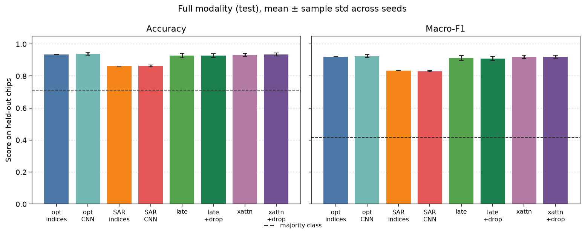
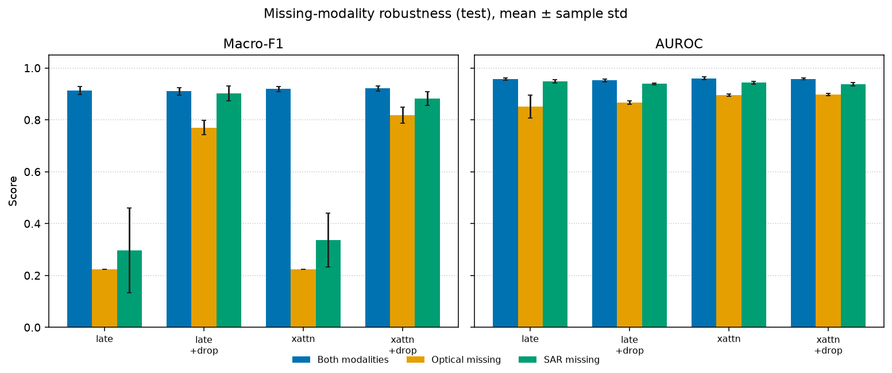
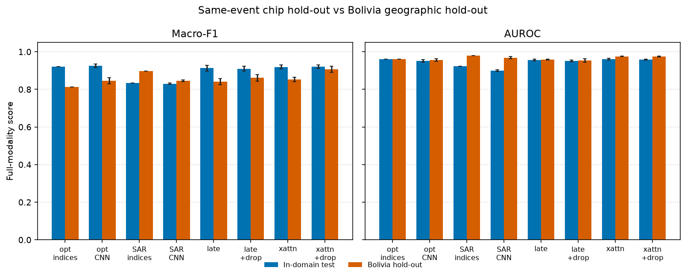

# eo-multimodal-fuse

Paired Sentinel-1 / Sentinel-2 water classification: unimodal baselines versus late fusion and cross-attention, with a missing-modality check. Five training seeds. The numbers below are from one CPU run of the command in [Reproduce](#reproduce), not from a synthetic generator.

## Problem

Flood mapping is a setting where the second sensor is not automatically an accuracy gain. Clouds often cover the optical image when a water map is needed, and SAR sees through clouds but is harder to read. Two questions:

1. When both modalities are present, does fusion beat a strong unimodal model, including a classical water-index model?
2. If one modality is replaced by zeros at test time, does the fusion model still make a usable decision?

## Data

**Sen1Floods11 v1.1, hand-labeled chips** (Bonafilia et al., CVPR Workshops 2020). Public HTTPS bucket, no account: `https://storage.googleapis.com/sen1floods11/v1.1/`.

So2Sat LCZ42 is the usual paired Sentinel-1/2 classification set, but it does not fit the size budget. On the Hugging Face mirror `zhu-xlab/So2Sat-LCZ42`, `v4/validation.h5.gz` is 1.10 GB and `v4/training.h5.gz` is 16.0 GB. SEN12MS is distributed as multi-gigabyte seasonal archives. Sen1Floods11 stores one Cloud-Optimized GeoTIFF per chip, so a fixed chip subset is small. This run downloaded **294,044,804 bytes (294 MB)** of GeoTIFFs.

The full Sen1Floods11 hand-labeled archive is larger (the authors quote about 14 GB for the whole bucket, including weak labels). This benchmark does not download that. It also does not reproduce the paper's pixel-segmentation IoU. The task here is patch classification.

| Piece | Choice |
|---|---|
| Labels | Analyst `LabelHand` only. Sentinel-1 Otsu weak labels are not used, so SAR is not copied into the target. |
| SAR | Sentinel-1 GRD, VV and VH, dB. CNN input is clipped to [-30, 5] dB and scaled to [0, 1]. |
| Optical | Sentinel-2 L1C TOA, bands B2, B3, B4, B8, B11, B12, reflectance clipped to [0, 1]. |
| Patch | 64×64, non-overlapping. Dropped if fewer than 90% of pixels are valid (label 0 or 1). |
| Positive class | Water fraction among valid pixels ≥ 0.05. |

Subset rule, fixed before training and not chosen by test score. Within each event, chips are sorted by id and taken at evenly spaced indexes.

| Split | Source list | Chips | Patches | Positive rate |
|---|---|---:|---:|---:|
| Train | 4 chips/event from `flood_train_data.csv` | 40 | 2039 | 0.285 |
| In-domain test | 2 chips/event from `flood_test_data.csv` | 20 | 1053 | 0.288 |
| Bolivia | every chip in `flood_bolivia_data.csv` | 15 | 494 | 0.332 |

Train and the in-domain test use the authors' chip split: same flood events, different chips. Bolivia is the authors' geographic hold-out. It is not used for training or for picking hyperparameters. Chip ids are listed in `results/metrics.json`.

## Method

All neural nets are small on purpose (3×3 convolutions, width 16, three pooling stages). Optimizer is AdamW, learning rate 1e-3, weight decay 1e-4, batch size 64, 8 epochs, inverse-frequency cross-entropy. Seeds are 0, 1, 2, 3, 4. Each method is constructed and trained from that seed on its own, so method order does not change its result.

| Method | What it is |
|---|---|
| `majority_class` | Training-set majority label. AUROC uses a constant score equal to the training positive rate, which is 0.5 when both classes are present. |
| `optical_indices` | Logistic regression on per-patch means of the six optical bands, NDWI, MNDWI, NDVI, and the standard deviation of NIR and SWIR1. Balanced class weight. Scaler fit on train only. |
| `sar_indices` | Logistic regression on mean VV, mean VH, mean VH−VV, and the standard deviations of VV and VH. |
| `optical_only`, `sar_only` | Unimodal CNNs. |
| `late_fusion` | Concatenate pooled optical and SAR embeddings. |
| `cross_attention_fusion` | Optical spatial tokens query SAR tokens (one attention layer), then a two-layer head. |
| `*_moddrop` | Same fusion nets with modality dropout probability 0.5. Each training sample zeros either optical or SAR, never both. |

Missing-modality evaluation uses that same zero tensor. It is not a cloud mask and not a learned missing token. Macro-F1 is the unweighted mean of the two class F1 scores with `zero_division=0`, so a missing predicted class scores 0 instead of NaN. AUROC is omitted (JSON `null`, CSV `undefined`, with a note) only when it is undefined. In this run both classes are present in every split, so every AUROC is defined. Sample standard deviation uses divisor n−1. Index models and the majority baseline are deterministic given the patches, so their seed standard deviation is 0.

`--demo` still trains the old synthetic feature MLPs and does not download anything. Those numbers are not the table below.

## Reproduce

From the repository root, on macOS, with Python 3.12. The same command is what produced `results/` and `figures/`.

```bash
python3.12 -m venv .venv
source .venv/bin/activate
python -m pip install --upgrade pip
python -m pip install -r requirements.txt
python -m pip install -e .
python -m eo_multimodal_fuse --out results --data-dir data/sen1floods11 --seeds 0,1,2,3,4 --epochs 8 --publish-figures figures
```

That downloads the 75 chips into `data/sen1floods11/` (gitignored) and writes metrics, the CSV, and the figures. Offline fallback:

```bash
python -m eo_multimodal_fuse --demo --out output/demo
```

This run was on a Linux x86_64 VM, 4 CPU threads, PyTorch 2.14.1+cpu, device `cpu`. Wall time was **308 seconds**, of which data preparation was 8.3 seconds. A Mac mini was not timed. The model is a few million MACs per patch, so a Mac mini CPU running this same command should stay well under half an hour unless the download is slow.

## Results

Mean ± sample standard deviation across the five seeds. Source files: `results/metrics.json`, `results/metrics_table.csv`, `results/metrics_by_seed.csv`.

### In-domain test, both modalities

| Method | Condition | Accuracy | Macro-F1 | AUROC |
|---|---|---|---|---|
| majority_class | full | 0.712 ± 0.000 | 0.416 ± 0.000 | 0.500 ± 0.000 |
| optical_indices | full | 0.934 ± 0.000 | 0.920 ± 0.000 | 0.960 ± 0.000 |
| optical_only | full | 0.939 ± 0.009 | 0.926 ± 0.010 | 0.952 ± 0.007 |
| sar_indices | full | 0.861 ± 0.000 | 0.835 ± 0.000 | 0.923 ± 0.000 |
| sar_only | full | 0.864 ± 0.006 | 0.830 ± 0.004 | 0.901 ± 0.005 |
| late_fusion | full | 0.928 ± 0.014 | 0.913 ± 0.015 | 0.956 ± 0.004 |
| late_fusion_moddrop | full | 0.928 ± 0.012 | 0.910 ± 0.014 | 0.952 ± 0.005 |
| cross_attention_fusion | full | 0.933 ± 0.010 | 0.919 ± 0.011 | 0.960 ± 0.005 |
| cross_attention_fusion_moddrop | full | 0.935 ± 0.009 | 0.921 ± 0.010 | 0.958 ± 0.003 |

Fusion does not beat the optical models on this split. The optical CNN macro-F1 is 0.926 ± 0.010. The best fusion macro-F1 is 0.921 ± 0.010 (cross-attention with modality dropout). The optical index logistic regression is 0.920 with no seed noise. Those gaps are inside the seed standard deviation. SAR is worse (macro-F1 about 0.83) and still well above the majority-class macro-F1 of 0.416.

Training-set macro-F1 for the six CNNs, averaged over seeds, sits between 0.820 (SAR CNN) and 0.904 (cross-attention). That is the same band as the in-domain test, so the test numbers are not a memorization spike.



### In-domain test, missing modality

| Method | Condition | Accuracy | Macro-F1 | AUROC |
|---|---|---|---|---|
| late_fusion | full | 0.928 ± 0.014 | 0.913 ± 0.015 | 0.956 ± 0.004 |
| late_fusion | optical_missing | 0.288 ± 0.000 | 0.223 ± 0.000 | 0.851 ± 0.043 |
| late_fusion | sar_missing | 0.348 ± 0.135 | 0.296 ± 0.163 | 0.948 ± 0.006 |
| late_fusion_moddrop | full | 0.928 ± 0.012 | 0.910 ± 0.014 | 0.952 ± 0.005 |
| late_fusion_moddrop | optical_missing | 0.819 ± 0.039 | 0.770 ± 0.028 | 0.866 ± 0.007 |
| late_fusion_moddrop | sar_missing | 0.917 ± 0.028 | 0.901 ± 0.029 | 0.938 ± 0.004 |
| cross_attention_fusion | full | 0.933 ± 0.010 | 0.919 ± 0.011 | 0.960 ± 0.005 |
| cross_attention_fusion | optical_missing | 0.288 ± 0.000 | 0.223 ± 0.000 | 0.895 ± 0.005 |
| cross_attention_fusion | sar_missing | 0.370 ± 0.076 | 0.337 ± 0.104 | 0.943 ± 0.006 |
| cross_attention_fusion_moddrop | full | 0.935 ± 0.009 | 0.921 ± 0.010 | 0.958 ± 0.003 |
| cross_attention_fusion_moddrop | optical_missing | 0.843 ± 0.036 | 0.817 ± 0.031 | 0.897 ± 0.005 |
| cross_attention_fusion_moddrop | sar_missing | 0.898 ± 0.025 | 0.882 ± 0.026 | 0.938 ± 0.007 |

This is the comparison that is outside the noise. Without modality dropout, zeroing the optical input makes both fusion nets predict the positive class on every in-domain test patch (predicted-positive rate 1.0 in all 5 seeds). Accuracy equals the positive rate, 0.288, and macro-F1 is 0.223. AUROC stays high (0.85–0.90), so the ranking has not died; the hard decision has. Zeroing SAR without dropout is unstable across seeds (late-fusion accuracy 0.348 ± 0.135) and collapses in most seeds. `results/metrics.json` records the collapse in `notes`. Nothing in the metrics files is NaN.

Modality dropout stops that collapse and does not change full-modality macro-F1 by more than the seed noise. Cross-attention with dropout keeps macro-F1 at 0.817 ± 0.031 if optical is missing and 0.882 ± 0.026 if SAR is missing.



### Bolivia geographic hold-out, both modalities

| Method | Condition | Accuracy | Macro-F1 | AUROC |
|---|---|---|---|---|
| majority_class | full | 0.668 ± 0.000 | 0.400 ± 0.000 | 0.500 ± 0.000 |
| optical_indices | full | 0.818 ± 0.000 | 0.812 ± 0.000 | 0.960 ± 0.000 |
| optical_only | full | 0.855 ± 0.018 | 0.846 ± 0.017 | 0.957 ± 0.007 |
| sar_indices | full | 0.913 ± 0.000 | 0.898 ± 0.000 | 0.979 ± 0.000 |
| sar_only | full | 0.874 ± 0.002 | 0.845 ± 0.004 | 0.969 ± 0.006 |
| late_fusion | full | 0.851 ± 0.018 | 0.842 ± 0.017 | 0.957 ± 0.002 |
| late_fusion_moddrop | full | 0.877 ± 0.018 | 0.862 ± 0.018 | 0.954 ± 0.009 |
| cross_attention_fusion | full | 0.860 ± 0.012 | 0.853 ± 0.011 | 0.976 ± 0.001 |
| cross_attention_fusion_moddrop | full | 0.916 ± 0.017 | 0.907 ± 0.017 | 0.976 ± 0.002 |

On Bolivia the order changes. The optical CNN macro-F1 falls from 0.926 in-domain to 0.846 ± 0.017. The SAR index model is the strongest simple baseline: macro-F1 0.898, AUROC 0.979. Cross-attention with modality dropout reaches macro-F1 0.907 ± 0.017 and AUROC 0.976 ± 0.002. That is not a clean win over the SAR index model: the accuracy gap is 0.003 (0.916 versus 0.913) and the fusion seed standard deviation is 0.017. Late fusion does not beat the SAR index model.



Bolivia missing-modality numbers are in `results/table.md`. The same pattern shows up. Without dropout, zeroing either modality collapses predictions onto the positive class (accuracy 0.332, the Bolivia positive rate, for cross-attention in all 5 seeds) while AUROC stays above 0.92. With dropout, cross-attention macro-F1 is 0.902 ± 0.012 if optical is missing and 0.762 ± 0.055 if SAR is missing.

## Limitations

- This is a 75-chip subset and a 64×64 patch label, not Sen1Floods11 segmentation and not a leaderboard number.
- The in-domain test shares flood events with training. Chips are a few kilometers apart, so spatial correlation can inflate those scores. Bolivia is the geographic check, and it is only 15 chips / 494 patches.
- Error bars are training-seed noise only. They are not a bootstrap over chips or events.
- Width, epochs, the 0.05 water fraction, and dropout 0.5 were fixed for a CPU budget. They were not swept on the test set.
- A missing sensor is an all-zero normalized tensor. Real cloud is not zero, and there is no learned mask token.
- Sentinel-2 here is L1C top-of-atmosphere. B11 and B12 are 20 m bands already resampled to 10 m in the GeoTIFFs.
- Class-weighted cross-entropy moves the argmax threshold. High AUROC with a collapsed hard prediction, in the no-dropout missing-modality rows, is that mismatch plus an input the model did not see in training.
- Index-model standard deviations are 0 because the fit does not depend on the seed. That is not a claim of zero uncertainty.

## License

Code: MIT. Sen1Floods11 chips are downloaded at runtime from the authors' public bucket and are not stored in this repository. Cite Bonafilia, Tellman, Anderson, and Issenberg, "Sen1Floods11: a georeferenced dataset to train and test deep learning flood algorithms for Sentinel-1," CVPR Workshops 2020. Sentinel-1 and Sentinel-2 data are Copernicus.
